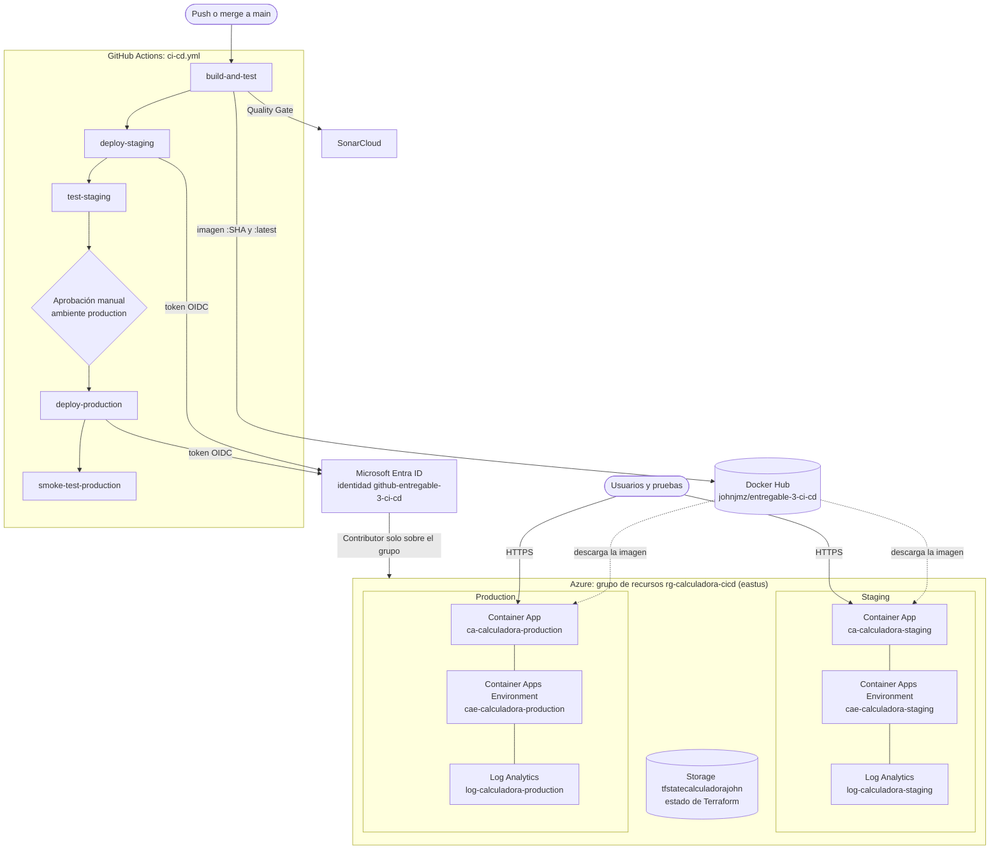

# entregable-3-ci-cd

Taller Entregable 3 del curso de CI/CD: despliegue continuo de la calculadora web en Flask a **Azure Container Apps**, con ambientes de **Staging** y **Producción** creados con **Terraform** y desplegados desde **GitHub Actions**.

El enunciado está escrito para AWS (ECS, ALB y S3). Este repositorio implementa la misma solución en Azure; cada recurso de AWS tiene su equivalente en la sección [Arquitectura en Azure](#arquitectura-en-azure).

## Integrantes

Texto usado en `AUTOR` (`app/calculadora.py`): **John Jimenez**

| Nombre completo | Usuario de GitHub | Rol |
|---|---|---|
| John Jimenez | [@Johnjmz13](https://github.com/Johnjmz13) | Propietario del repositorio |

Modalidad: individual.

## Arquitectura en Azure



### Equivalencia con el enunciado (AWS → Azure)

| Enunciado (AWS) | Implementación (Azure) | Para qué sirve |
|---|---|---|
| Bucket S3 `tfstate-calculadora-*` con versionado y bloqueo | Storage Account `tfstatecalculadorajohn`, contenedor `tfstate`, con versionado de blobs y bloqueo por *lease* | Estado remoto de Terraform, un archivo por workspace (`staging` y `production`) |
| `LabRole` y llaves temporales `AWS_*` en los secretos | App Registration `github-entregable-3-ci-cd` con credenciales federadas OIDC. Secretos `AZURE_CLIENT_ID`, `AZURE_TENANT_ID` y `AZURE_SUBSCRIPTION_ID` | Identidad con la que el pipeline crea los recursos, sin contraseñas guardadas |
| VPC y subredes por defecto (Terraform solo las consulta) | Grupo de recursos `rg-calculadora-cicd` (Terraform solo lo consulta) | Lugar donde se crean los ambientes |
| Cluster ECS | Container Apps Environment `cae-calculadora-<ambiente>` | Entorno donde corren los contenedores |
| Task Definition y Servicio ECS | Container App `ca-calculadora-<ambiente>`: 0.25 vCPU, 0.5 GiB, máximo 1 réplica, variable `APP_VERSION` | Ejecuta la imagen Docker |
| ALB, Target Group y Security Groups | Ingress HTTPS de la Container App: solo expone el puerto 443, con certificado TLS automático, y envía el tráfico al puerto 8000 | URL pública del ambiente |
| Health check del Target Group en `/health` | Sondas *startup*, *readiness* y *liveness* en `/health` | Decidir qué réplica recibe tráfico y cuál se reinicia |
| Despliegue gradual con *circuit breaker* | Modo de revisión única (*Single revision mode*) | Desplegar sin caída del servicio |
| CloudWatch Log Group `/ecs/calculadora-<ambiente>` (7 días) | Log Analytics `log-calculadora-<ambiente>` (30 días, el mínimo de Azure) | Logs de los contenedores |

En AWS, Terraform crea 9 recursos por ambiente. En Azure crea 3 por ambiente: Log Analytics, el ambiente y la Container App. El balanceador, los grupos de seguridad y el certificado vienen incluidos en Container Apps.

### Recursos compartidos (los crea una sola vez el script de preparación)

- **Grupo de recursos `rg-calculadora-cicd`** en `eastus`.
- **Storage Account `tfstatecalculadorajohn`.** Guarda un archivo de estado por workspace:
  - `calculadora/terraform.tfstateenv:staging`
  - `calculadora/terraform.tfstateenv:production`
- **App Registration `github-entregable-3-ci-cd`**, con rol **Contributor solo sobre el grupo de recursos** y no sobre toda la suscripción.

### Autenticación del pipeline sin contraseñas (OIDC)

En AWS Academy había que copiar 3 llaves temporales a los secretos de GitHub cada vez que vencía la sesión del laboratorio. Aquí no se guarda ninguna contraseña:

1. Los jobs de despliegue tienen el permiso `id-token: write`. GitHub les entrega un token firmado que dura minutos y que dice qué repositorio y qué ambiente lo pide: `repo:Johnjmz13@281732331/entregable-3-ci-cd@1459555815:environment:staging`.
2. Terraform presenta ese token a Microsoft Entra ID (`ARM_USE_OIDC=true`).
3. Entra ID solo lo acepta si coincide con una de las 2 credenciales federadas de la App Registration (`github-staging` o `github-production`). Entonces entrega un token de acceso a Azure.

Los secretos `AZURE_*` son identificadores, no contraseñas, y no vencen. Un workflow de otro repositorio, o de una rama sin ambiente, no puede usar esta identidad. El formato del token incluye los ID numéricos del usuario y del repositorio, así que un repositorio borrado y vuelto a crear con el mismo nombre tampoco hereda el acceso.

### Health checks, despliegue sin caída y rollback

Cada Container App tiene 3 sondas sobre `/health`, que es el equivalente al health check del Target Group:

| Sonda | Configuración | Qué hace si falla |
|---|---|---|
| *Startup* | Cada 5 s, hasta 12 fallos (60 s para arrancar) | Reinicia el contenedor. Mientras arranca, las otras sondas no se evalúan |
| *Readiness* | Cada 10 s, 3 fallos | Saca la réplica del balanceo: deja de recibir tráfico sin reiniciarse, como un target `unhealthy` |
| *Liveness* | Cada 30 s, 3 fallos | Reinicia el contenedor, como ECS cuando reemplaza una tarea |

**Despliegue sin caída.** Cada despliegue cambia la imagen y `APP_VERSION`, y eso crea una **revisión** nueva de la Container App. En modo de revisión única, Azure no desactiva la revisión anterior hasta que la nueva está lista. Mientras tanto, la anterior sigue recibiendo el 100 % del tráfico, como el `deployment_minimum_healthy_percent = 100` de ECS.

**Rollback.** Si la revisión nueva nunca pasa sus sondas, nunca recibe tráfico y la anterior sigue atendiendo. No hay que revertir nada, porque la versión anterior no se apagó; el efecto equivale al *circuit breaker* de ECS. El pipeline lo detecta de dos formas:
- `terraform apply` termina con error si Azure marca la revisión como fallida.
- Si no, el paso de espera de `test-staging` o de `smoke-test-production` falla, porque `/health` sigue mostrando el SHA anterior.

Si pasa en Staging, la versión defectuosa nunca llega a Producción.

**Logs.** Los logs de cada contenedor quedan en Log Analytics (`log-calculadora-<ambiente>` → **Logs**) durante 30 días. También se ven en vivo en **Container App → Monitoring → Log stream**.

### Costos

| Recurso | Costo esperado |
|---|---|
| Container Apps | Las apps **escalan a cero** (`min_replicas = 0`): unos minutos sin tráfico y se apagan, y apagadas no cobran cómputo. Cada mes son gratis, por suscripción, 180.000 vCPU-segundos, 360.000 GiB-segundos y 2 millones de peticiones. La contrapartida es que la primera petición después de un rato tarda unos segundos mientras la app arranca |
| Log Analytics | Los primeros 5 GB al mes son gratis y la retención de 31 días está incluida. Esta app genera pocos KB al día, y un tope diario de 50 MB evita sorpresas |
| Storage Account | Centavos al mes por unos KB de estado |
| Imagen Docker | Docker Hub público, sin costo, en lugar de un Azure Container Registry |

## Cómo ejecutar

```bash
python -m venv venv
venv\Scripts\activate          # Windows
pip install -r requirements-dev.txt

python -m app.app              # http://localhost:5000 y http://localhost:5000/health

# Pruebas unitarias y de componente (cobertura mínima 80%)
pytest --ignore=tests/test_acceptance_app.py --ignore=tests/test_smoke_app.py --cov-fail-under=80

# Pruebas de aceptación (con la app en ejecución)
pytest tests/test_acceptance_app.py --no-cov --html=acceptance-report.html
```

## Evidencias

- **Ejecución del pipeline del merge de las nuevas funciones** (5 jobs en verde y aprobación de Producción): **PENDIENTE**: URL de la ejecución.
- **Pull Request de las nuevas funciones:** **PENDIENTE**: URL del PR.
- **Primer despliegue de los dos ambientes**, con la aprobación de Producción: https://github.com/Johnjmz13/entregable-3-ci-cd/actions/runs/44014796315
- **URLs de los ambientes.** Equivalen a las URLs de los ALB del enunciado:

  ```plaintext
  Staging:    https://ca-calculadora-staging.ambitiousstone-3c18401a.eastus.azurecontainerapps.io
  Production: https://ca-calculadora-production.wonderfulstone-cbed89b0.eastus.azurecontainerapps.io
  ```

- **Operación nueva en Producción:**

  

- **Revisión de Producción saludable.** Reemplaza la captura del Target Group: **Container App `ca-calculadora-production` → Revisions and replicas**, con la revisión activa en estado *Running* y su réplica en ejecución.

  

## Respuestas

### 1. Flujo completo del pipeline

Todo push o merge a `main` ejecuta `.github/workflows/ci-cd.yml`, salvo los cambios que solo tocan archivos `.md` o la carpeta `docs/` (`paths-ignore`). En un Pull Request solo corre `build-and-test`. El artefacto que viaja es **una sola imagen Docker, construida una vez**: `docker.io/johnjmz/entregable-3-ci-cd:<SHA del commit>`. Staging y Producción ejecutan exactamente la misma imagen. Entre jobs no se copia la imagen, sino su nombre, como salida del job (`image_uri`). Las URLs de los ambientes también pasan como salidas de Terraform (`app_url`).

1. **`build-and-test` (CI).**
   - Instala las dependencias verificadas con hash.
   - Revisa el formato con Black y el estilo con Pylint y Flake8.
   - Corre las **pruebas unitarias**, que prueban las funciones de `calculadora.py` aisladas, y las **de componente**, que prueban las rutas de Flask con el cliente de pruebas, incluidos el token CSRF y `/health`. Exige cobertura ≥ 80 %.
   - Valida Terraform con `fmt -check` y `validate`.
   - Construye la imagen, la levanta en el runner y corre las **pruebas de aceptación** con Selenium sobre ese contenedor.
   - Envía el análisis a SonarCloud y espera la Quality Gate.
   - Solo en `main`, sube la imagen a Docker Hub con las etiquetas `:SHA` y `:latest`.
2. **`deploy-staging`.**
   - Se autentica en Azure por OIDC.
   - Ejecuta `terraform init` con el estado remoto y selecciona el workspace `staging`.
   - Aplica `terraform apply` con la imagen del paso anterior y `APP_VERSION = SHA`. Azure crea una revisión nueva de la Container App.
   - Publica la URL del ambiente.
3. **`test-staging`.**
   - Espera hasta que `/health` de Staging responda con el SHA nuevo (máximo 30 intentos cada 10 s), para no probar la versión anterior.
   - Corre las **pruebas de aceptación** contra la URL real. Validan, desde un navegador, que el usuario puede usar cada operación y que se muestran los errores (división por cero, datos no numéricos).
4. **Aprobación manual.** El job `deploy-production` usa `environment: production`, que exige un revisor. Queda en *Waiting* hasta que alguien lo aprueba en **Review deployments**.
5. **`deploy-production`.** Hace lo mismo que `deploy-staging`, pero en el workspace `production` y con la misma imagen.
6. **`smoke-test-production`.** Espera el SHA nuevo en Producción y corre las **pruebas de humo**. Validan rápido y sin modificar nada que la página principal carga y que `/health` responde `ok` con la versión esperada.

Los reportes de pruebas, cobertura y linters se guardan como artefactos de cada ejecución.

### 2. Terraform frente a la consola, y por qué el estado es remoto

**Ventajas**
- **Repetible:** el mismo código crea Staging y Producción idénticos. Solo cambia el workspace y la variable `environment_name`.
- **Versionado y revisable:** la infraestructura vive en Git como el código, y los cambios pasan por Pull Request.
- **Predecible:** `terraform plan` muestra qué va a cambiar antes de hacerlo.
- **Automatizable:** se ejecuta desde el pipeline sin entrar al portal.
- **Fácil de limpiar:** `terraform destroy` borra exactamente lo que se creó.

**Desventajas**
- **Curva de aprendizaje:** HCL, proveedores, workspaces y estado. Por ejemplo, hubo que fijar la versión del proveedor `azurerm`, porque una versión mayor cambia el esquema.
- **Errores tardíos:** algunos errores solo aparecen al aplicar, no al validar.
- **Desviaciones:** si alguien cambia algo a mano en el portal, el estado deja de coincidir con la realidad.
- **Datos sensibles:** el estado puede contener datos sensibles, así que hay que protegerlo.

**Por qué el estado no está en el computador.** En el enunciado va en un bucket S3; aquí, en una Storage Account de Azure.
- **Runners efímeros:** cada job de GitHub Actions corre en una máquina nueva que se borra al terminar. Con un estado local, cada ejecución empezaría sin memoria e intentaría crear todo otra vez.
- **Estado compartido:** el pipeline y una persona en su computador (por ejemplo, para el `destroy` final) trabajan sobre el mismo estado.
- **Bloqueo:** el *lease* del blob impide dos `apply` simultáneos sobre el mismo ambiente.
- **Historial:** el versionado permite recuperar un estado anterior si se corrompe.
- **No depende de un solo computador.** Además, el acceso lo controla Azure con sus permisos.

### 3. Ventajas y desventajas de Staging

**Ventajas**
- Prueba la versión nueva en un ambiente igual a Producción (mismo código de Terraform y misma imagen) antes de que la vea un usuario.
- Las pruebas de aceptación corren contra infraestructura real: ingress HTTPS, sondas y red de Azure. Eso no se cubre con el contenedor local del CI.
- Da un lugar para revisar a mano antes de aprobar.
- Si algo falla, el pipeline se detiene y Producción no cambia.

**Desventajas**
- **Costo:** es el doble de infraestructura. Aquí se mitiga escalando a cero.
- **Tiempo:** cada entrega tarda varios minutos más (desplegar y probar Staging).
- **Mantenimiento:** hay más recursos que mantener.
- **No es idéntico a Producción:** Staging no tiene el tráfico ni los datos reales.

**Velocidad frente a seguridad.** Staging hace cada entrega un poco más lenta, pero reduce mucho el riesgo de romper Producción. Como todo es automático, el costo en tiempo es bajo. La aprobación manual es el único punto que depende de una persona, y es una decisión consciente: se cambia un poco de velocidad por control.

### 4. Pruebas en Staging frente a pruebas en Producción

- **`test-staging`** ejecuta la suite completa de aceptación con Selenium: abre un navegador, usa cada operación y verifica los mensajes de error. Es exhaustiva, más lenta y genera tráfico de prueba.
- **`smoke-test-production`** ejecuta solo 2 verificaciones rápidas con `urllib`, de la librería estándar: que la página principal carga y que `/health` responde `ok` con el SHA esperado.

La diferencia es intencional:
- La funcionalidad ya se validó en Staging con la misma imagen. En Producción solo falta confirmar que **ese despliegue** quedó bien: la versión correcta, arriba y accesible.
- En Producción hay usuarios reales, así que conviene probar rápido, sin carga extra y sin efectos secundarios.

### 5. Qué le falta al pipeline en un ciclo DevOps completo

1. **Monitoreo y alertas (fase de operación).** Hoy los logs se guardan, pero nadie se entera si la app empieza a fallar después del despliegue. Se podría implementar así:
   - Reglas de alerta de Azure Monitor sobre las métricas de la Container App: respuestas 5xx o reinicios de réplicas. Avisarían por correo mediante un *Action Group*.
   - Una prueba de disponibilidad periódica sobre `/health`.
   - Application Insights para medir latencia y errores por petición.
2. **Entrega progresiva con rollback automático.** Hoy la versión nueva recibe el 100 % del tráfico apenas está lista. Con el *Multiple revision mode* de Container Apps se podría:
   - Enviar primero el 10 % del tráfico a la revisión nueva (*canary*) y revisar sus métricas.
   - Pasar al 100 % si todo va bien, o devolver el tráfico a la revisión anterior con `az containerapp ingress traffic set` si falla. Esa decisión se puede automatizar en el pipeline.

Otras prácticas que también faltan: escanear la imagen en busca de vulnerabilidades (por ejemplo, con Trivy) y publicar el `terraform plan` en cada Pull Request para revisar los cambios de infraestructura antes del merge.

### 6. Experiencia con las nuevas funcionalidades y el pipeline

**John Jimenez:** **PENDIENTE**: escribir con tus palabras al terminar el PR de las nuevas operaciones. Ideas, solo si te pasaron:
- Qué tal fue agregar potencia y módulo con las pruebas.
- Si el pipeline detectó algún error antes de llegar a Producción.
- Lo útil de no desplegar a mano.
- Lo menos útil: esperas largas en el primer despliegue, depurar fallos de configuración (identidad OIDC de Azure, permisos del token de Docker Hub, primer análisis de SonarCloud) y dejar que el pipeline lo arreglara relanzando jobs.

### 7. ¿Entrega Continua o Despliegue Continuo?

**Entrega Continua.** Staging se actualiza solo con cada cambio en `main`, pero Producción solo se despliega cuando una persona aprueba el job `deploy-production` (revisores requeridos en el ambiente `production`). Con Despliegue Continuo, todo lo que pasa las pruebas en Staging llegaría solo a Producción.

**Qué se revisó en Staging antes de aprobar:** **PENDIENTE**: confirmar al hacer el merge. Por ejemplo:
- Abrir la URL de Staging y probar las operaciones nuevas, incluido el caso de error de módulo por cero.
- Verificar que `/health` mostrara el SHA del merge.
- Revisar que `test-staging` estuviera en verde.

**Si la versión nueva no pasara el health check:**
- **En Azure:** la revisión nueva fallaría sus sondas. *Startup* y *liveness* reiniciarían el contenedor, y *readiness* nunca la marcaría lista para recibir tráfico. En modo de revisión única, Azure no desactiva la revisión anterior hasta que la nueva está lista, así que la versión anterior seguiría atendiendo sin interrupción. En el portal, la revisión nueva aparecería como fallida en **Revisions and replicas**. El efecto equivale a la reversión del *circuit breaker* de ECS.
- **En el pipeline:** `terraform apply` terminaría con error si Azure marca la revisión como fallida. Si no, el paso de espera de `test-staging` fallaría, porque `/health` seguiría mostrando el SHA anterior. En ambos casos el pipeline se detiene en Staging y la versión defectuosa nunca llega a Producción.
